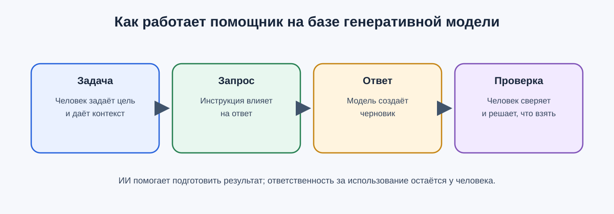

# Урок 1. Что такое ИИ и генеративные модели

**Цель:** понять базовые понятия и выбрать подходящие задачи для ИИ.

## Коротко

Искусственный интеллект (ИИ) — общее название компьютерных систем, которые выполняют задачи, обычно требующие человеческих способностей: распознают речь и изображения, находят закономерности, составляют прогнозы или создают тексты.

Генеративная модель обучена находить закономерности в примерах и создавать новый материал: текст, изображение, звук или код. Чат-ассистент — интерфейс, который принимает ваши инструкции и контекст и выдаёт ответ. Он не «понимает» задачу так же, как человек, и может уверенно ошибаться.

Упрощённо: вы формулируете запрос → модель строит ответ на основе контекста и выученных закономерностей → вы проверяете результат и решаете, что с ним делать. Ответ зависит от формулировки, контекста, модели и доступных ей инструментов.

Подходящие стартовые задачи: сделать черновик письма, сократить текст, предложить структуру, составить список вопросов, объяснить понятие простыми словами, преобразовать заметки в таблицу. Решения с юридическими, финансовыми, медицинскими, кадровыми или безопасностными последствиями требуют проверки компетентным человеком.

## Практика: найти подходящую задачу (25–35 минут)

**Подготовьте:** блокнот или раздел 1 рабочей тетради. Не используйте реальные клиентские или рабочие данные.

1. Запишите пять частых задач. Для каждой укажите частоту, примерное время, насколько легко проверить результат и что случится при ошибке.
2. Выберите задачу с низким риском и понятным результатом. Примеры: превратить вымышленные заметки в список дел, сократить учебный текст, составить план встречи.
3. Выберите ChatGPT или Codex и отправьте один запрос: «Объясни, какие части моей задачи можно поручить ИИ, какие данные нужны, какие ошибки возможны и как мне проверить результат. Задача: [описание без личных данных]».
4. Попросите перечислить три допущения и задать вопросы, если существенных данных не хватает.
5. Сверьте ответ со своим опытом. Отметьте одну полезную часть, одну неподтверждённую догадку и способ проверки.
6. Заполните таблицу в рабочей тетради.

**Если выбрали Codex:** попросите сохранить вывод в `praktika/moj-mini-proekt/idei.md`, затем прочитайте файл и проверьте список изменений. В ChatGPT сохраните выбранную идею в рабочей тетради.

**Результат:** одна низкорисковая задача и критерий проверки. Если выбрали Codex, добавьте файл `idei.md` в учебный проект; если ChatGPT — сохраните результат в рабочей тетради.

---

[Маршрут курса](../README.md) · [Самопроверка](../praktika/samoproverka.md) · [Урок 2 →](02-model-harness-agent.md)
