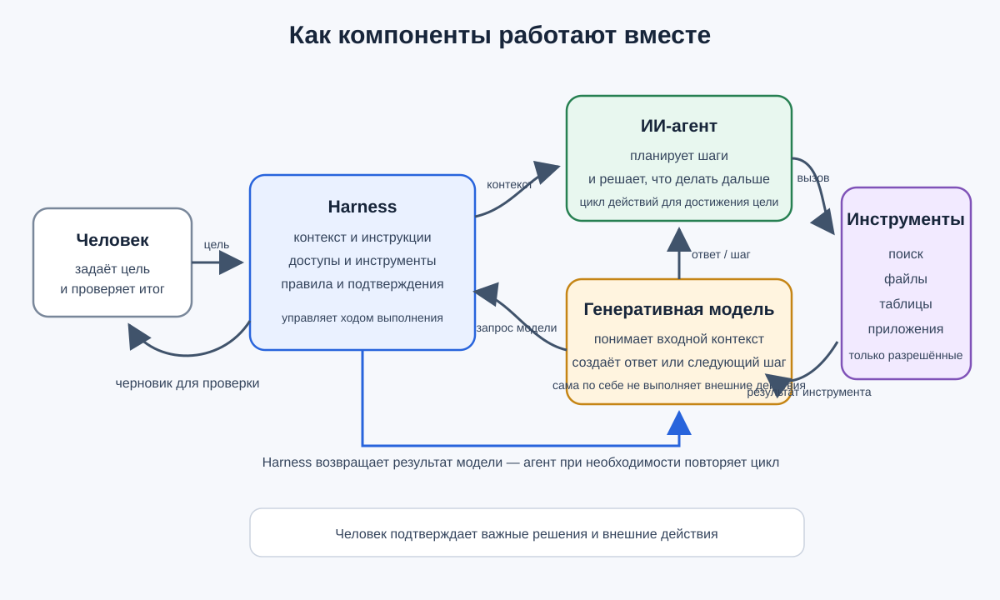

# Урок 2. Генеративная модель, harness и ИИ-агент

**Цель:** понять, из каких частей может состоять ИИ-помощник, чем отличаются модель, harness и агент и как они работают вместе.

## Три понятия

**Генеративная модель** — компонент, который по входному контексту генерирует ответ: например, текст, код или описание изображения. Она умеет обобщать выученные закономерности, но сама по себе обычно не знает, какие инструменты доступны, куда сохранить файл или можно ли отправить письмо. Она также может ошибаться и придумывать детали.

**Harness** (дословно — «обвязка»; также говорят «среда выполнения») — программная система вокруг модели, которая организует её работу. Harness собирает запрос и контекст, передаёт их модели, предоставляет доступные инструменты, получает результат и может проверять его, ограничивать действия, вести историю или просить подтверждение. Конкретный состав зависит от продукта. Чат-приложение — простой пример такой среды; у него может быть только интерфейс и история диалога, а у более сложного harness — файлы, поиск, код, правила и управление разрешениями.

**ИИ-агент** — система, которая использует модель и доступные инструменты для достижения заданной цели в несколько шагов. Агент может составить план, выполнить шаг, оценить результат и выбрать следующий шаг. Обычно он работает внутри harness, который задаёт инструменты и правила. Агентом называют именно поведение системы с циклом действий, а не отдельную модель. Разные продукты используют слово «агент» по-разному, поэтому стоит уточнять, какие действия система действительно умеет выполнять.

## Как они дополняют друг друга

Упрощённая схема:

`человек задаёт цель → harness собирает инструкции и контекст → модель предлагает следующий шаг → harness передаёт вызов нужному инструменту → результат возвращается модели → агент решает, что делать дальше → harness показывает итог и при необходимости запрашивает подтверждение`

Например, для подготовки еженедельной сводки:

1. Человек задаёт цель и формат сводки.
2. Harness добавляет инструкции, разрешённые источники и инструменты (например, поиск по выбранным файлам).
3. Модель составляет план и формирует запросы к инструментам.
4. Harness проверяет доступ и запускает поиск; результаты возвращаются модели.
5. Модель составляет черновик, агент при необходимости уточняет или собирает недостающие сведения.
6. Harness показывает сводку человеку; человек проверяет её перед распространением.

Модель даёт способность понимать запрос и создавать содержимое. Harness даёт контекст, инструменты и правила исполнения. Агент связывает несколько шагов в выполнение цели. Вместе они могут решать более длинные задачи, чем один запрос в пустом чате.

## Чем отличаются

| Часть | Главный вопрос | Пример роли |
|---|---|---|
| Генеративная модель | «Какой ответ или следующий шаг предложить?» | Составить краткое резюме предоставленного текста |
| Harness | «Как организовать безопасную и управляемую работу модели?» | Передать файл, подключить поиск, ограничить доступ, запросить подтверждение |
| ИИ-агент | «Как выполнить цель через несколько шагов?» | Найти материалы, извлечь факты, собрать черновик и сообщить, чего не хватает |

Границы не всегда видны пользователю: одно приложение может включать все три компонента. Кроме того, не каждая функция в интерфейсе означает, что работает агент: генерация одного ответа с подсказкой — ещё не многошаговое выполнение цели.

## Что важно контролировать

Чем больше система может сделать сама, тем важнее ограничить задачу и доступы. Для начала давайте агенту конкретную цель, разрешайте только нужные ему источники и инструменты, просите показать использованные данные и промежуточный результат. Отправку сообщений, удаление или изменение файлов, покупку и другие внешние действия оставляйте за человеком либо требуйте явного подтверждения. Harness может вводить такие ограничения, но их наличие следует проверять в конкретном приложении.

## Практика: одна задача в трёх режимах (35–50 минут)

**Подготовьте учебные заметки** (можно скопировать текст ниже):

> Пункт А: макет готов. Пункт Б: две иллюстрации ещё не получены. Пункт В: проверка занимает около часа. В заметках нет даты завершения и ответственного.

1. **ChatGPT, режим обычного ответа.** Начните новый чат, вставьте заметки и попросите: «Сделай сводку в трёх пунктах и перечисли, чего не хватает для плана. Не придумывай сроки и ответственных». Сохраните, какие части ответа основаны на тексте.
2. **ChatGPT, контекст через файл.** Сохраните те же заметки в `praktika/moj-mini-proekt/zametki.md` (в ChatGPT можно загрузить этот файл, если доступна загрузка). Попросите сделать ту же сводку, назвать использованный файл и указать отсутствующие данные. Обратите внимание, что файл, поиск и интерфейс относятся к возможностям приложения вокруг модели.
3. **Codex, работа с файлом.** Откройте папку курса в Codex и попросите прочитать только `praktika/moj-mini-proekt/zametki.md`, затем создать `praktika/moj-mini-proekt/svodka.md`. Запретите додумывать сроки, ответственных и действия. Codex использует модель, а доступ к файлам и внесение правок обеспечивает его среда (harness).
4. **Агентный цикл.** В Codex сформулируйте цель: «Составь сводку из файла, проверь её по исходным заметкам, укажи пробелы и остановись. Не отправляй её и не меняй другие файлы». Наблюдайте, делает ли Codex несколько шагов: читает источник, создаёт результат, повторно сверяет его. Если видите вызовы инструментов или план, отметьте их. Если приложение не показывает отдельный план, фиксируйте только наблюдаемые действия и не считайте слово “agent” доказательством самостоятельного цикла.
5. Уберите из исходника важное сведение и попросите повторить. Проверьте, появился ли вопрос или явная пометка о пробеле.
6. Заполните таблицу сравнения в рабочей тетради: компонент модели / harness / агентный шаг / кто проверяет.

**Если вы проходите урок только в ChatGPT:** выполните шаг 1, затем загрузите учебный файл (если загрузка доступна) и повторите сводку по нему. Агентный цикл разберите по схеме как мысленный эксперимент: перечислите нужные инструменты, шаги и точку проверки человеком.

**Если вы проходите урок в Codex:** выполните шаги 3–5, создайте файл сводки и наблюдайте, как Codex читает и редактирует проект. Сравнение с ChatGPT необязательно.

ChatGPT и Codex меняются, а функции зависят от версии и настроек. Если файловый или агентный режим недоступен, отметьте это и разберите отсутствующие шаги мысленно; не приписывайте инструменту ненаблюдаемые действия.

**Результат:** заполненное сравнение или разбор по схеме и пример, где человек должен остановить или проверить работу. При работе в Codex дополнительно сохраните `praktika/moj-mini-proekt/svodka.md`.

---

[← Урок 1](01-osnovy.md) · [Маршрут курса](../README.md) · [Самопроверка](../praktika/samoproverka.md) · [Урок 3 →](02-zaprosy.md)
