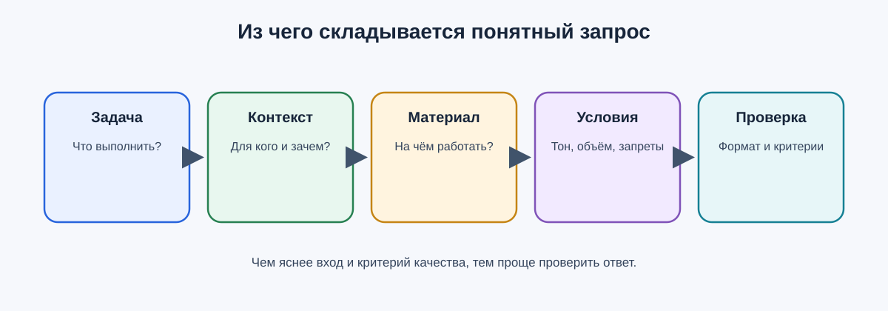

# Урок 3. Как ставить задачу: запросы и уточнения

**Цель:** получать более полезные и проверяемые ответы.

## Каркас запроса

- **Задача:** что нужно сделать.
- **Контекст:** для кого и зачем.
- **Материал:** текст или исходные данные.
- **Ограничения:** длина, тон, формат, что нельзя менять.
- **Проверка:** какие вопросы задать себе перед выдачей результата.

Шаблон: «Ты помогаешь [роль/задача]. Для [аудитория и цель] обработай материал ниже. Условия: [тон, объём, ограничения]. Верни результат в формате [формат]. Если данных не хватает, сначала задай до трёх вопросов. Не выдумывай факты; помечай предположения. Материал: …»

Роль может задать полезный стиль ответа, но сама по себе не добавляет модели знаний и не гарантирует точность. Большую задачу удобнее разбить на этапы: сначала план, затем черновик, после этого проверка.

## Практика: улучшить запрос в два прохода (25–35 минут)

**Ситуация:** еженедельный статус команды переносится на пятницу, 11:00; повестка прежняя; обновления нужно прислать до четверга, 16:00.

1. В новом чате выбранного инструмента отправьте короткий запрос: «Напиши сообщение команде о переносе еженедельного статуса на пятницу, 11:00».
2. Продолжите в выбранном инструменте. В ChatGPT храните черновики в чате; в Codex попросите создать `praktika/moj-mini-proekt/status-korotkiy.md`. Если хотите сравнить инструменты, повторите короткий запрос во втором и отметьте разницу.
3. Во втором запросе задайте аудиторию, цель, тон, оба времени, неизменную повестку, формат до 80 слов и правило не добавлять причин переноса. Попросите сначала задать вопрос, если данных недостаточно.
4. Попросите проверить результат по списку: пятница, 11:00; дедлайн четверг, 16:00; повестка прежняя; причина переноса не выдумана.
5. Исправьте ошибки сами. В Codex сохраните финальную версию как `praktika/moj-mini-proekt/status-provereno.md`, затем попросите сравнить её с исходными условиями и показать только расхождения.
6. Занесите лучший запрос и проверочный список в раздел 2 рабочей тетради.

**Результат:** проверенный текст и запрос-шаблон, который содержит задачу, контекст, ограничения, формат и проверку.
