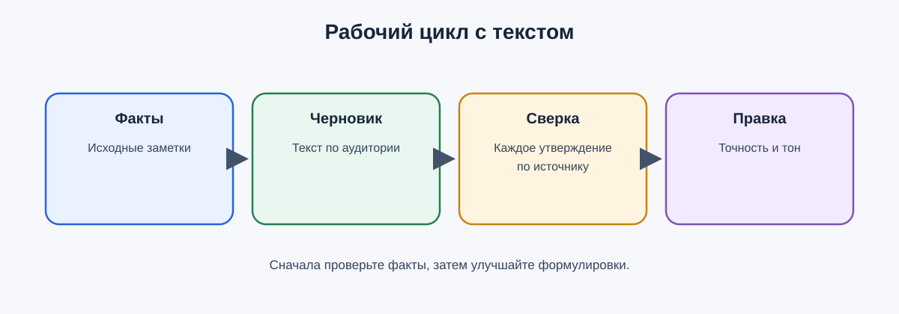

# Урок 4. Письма, тексты и редактура

**Цель:** использовать ИИ для черновиков и редактуры, сохраняя свой смысл и голос.

## Рабочий процесс

Дайте модели исходные факты и цель. Попросите черновик, а затем проверьте смысл, тон, имена, даты, обещания и отсутствие выдуманных деталей. Для редакторской задачи уточните, что можно менять: например, исправить грамматику и упростить фразы, сохранив факты и структуру.

ИИ может хорошо переформулировать, но не знает ваших отношений с адресатом, корпоративного стиля и невысказанных договорённостей, если вы не добавите их в контекст.

## Практика: внутреннее сообщение и ответ клиенту (30–40 минут)

**Исходные вымышленные заметки:** «Макет готов примерно наполовину; не хватает двух иллюстраций; дизайнер пришлёт их к среде; после получения нужно 1,5 часа на проверку; клиенту нужен статус сегодня».

1. В выбранном инструменте попросите составить внутреннее обновление в трёх пунктах: готово, блокер, следующий шаг. Запретите обещать дату завершения.
2. Отдельно попросите сделать вежливый клиентский статус до 70 слов. Укажите, что подтверждён только срок получения иллюстраций и что готовность макета неизвестна.
3. Попросите ассистента вывести таблицу «фраза / подтверждение в заметках / требует уточнения».
4. Если выбрали Codex, попросите сохранить клиентский черновик в `praktika/moj-mini-proekt/tekst-klienta.md` и сверить числа и сроки. Если выбрали ChatGPT, попросите сверку в чате и сохраните итог в тетради. В любом случае прочитайте и отредактируйте текст вручную.
5. Сравните текст до и после вашей правки. Удалите любые обещания, причины или факты, которых нет в исходных заметках.
6. Запишите в тетради одну правку, которая улучшила точность, и одну — тон.

**Результат:** два подходящих адресату текста, проверенных по источнику. В Codex сохраните клиентский черновик в учебной папке; в ChatGPT — в рабочей тетради.

---

[← Урок 3](02-zaprosy.md) · [Маршрут курса](../README.md) · [Самопроверка](../praktika/samoproverka.md) · [Урок 5 →](04-proverka.md)
