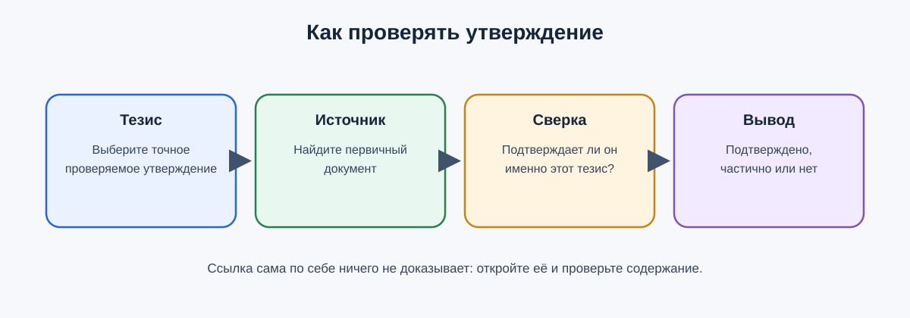

# Урок 5. Исследование и проверка фактов

**Цель:** распознавать ответы, которые требуют дополнительной проверки.

## Коротко

Модель может придумывать факты, цитаты и ссылки. Гладкий стиль не доказывает истинность. Разделяйте утверждения на проверяемые факты, оценки и рекомендации. Важные факты проверяйте по первоисточнику: официальной документации, нормативному акту, публикации или данным, на которые ссылается ответ.

Попросите отделить известное из предоставленного материала от выводов и предположений. Для изменчивой информации укажите дату и требуйте источники, которые можно открыть и проверить. Если ассистент не имеет доступа к вебу или файлам, его ответ не заменяет поиск по ним.

## Практика: проверить утверждения по источникам (35–50 минут)

Выберите знакомый изменяемый факт, например текущую цену или актуальное правило в известном вам сервисе. Не используйте ответ, влияющий на здоровье, финансы или законные права.

1. В ChatGPT или Codex спросите: «Объясни [тема] новичку и перечисли три конкретных утверждения, которые можно проверить. Раздели факты, оценку и предположение. Если не уверен, так и напиши».
2. Выберите два проверяемых утверждения. Откройте поиск в браузере и найдите первичный источник: официальную страницу или оригинальный документ. Не полагайтесь только на пересказ другой нейросети.
3. Попросите выбранный инструмент дать поисковые фразы и перечислить данные для проверки. Если доступен поиск по вебу, запросите ссылки, затем сами откройте их и проверьте, что страницы подтверждают тезис.
4. В Codex можно сохранить вывод в `praktika/moj-mini-proekt/proverka.md`. В ChatGPT заполните эти же поля в рабочей тетради. Вручную добавьте название и адрес первичного источника, подтверждающий или опровергающий фрагмент, дату проверки и вывод «подтверждено / опровергнуто / частично / не найдено».
5. Попросите инструмент отредактировать только ясность формулировок, не менять статусы и не добавлять новые источники. Сверьте результат с собственными заметками.
6. Зафиксируйте пример ошибки или ограничения и напишите правило проверки для будущей работы.

Если нет браузерного поиска, выполните вариант ниже. Не считайте выдуманные или непроверенные ссылки доказательством. Статус «не найдено» означает, что источник не даёт ответа; это не равнозначно опровержению.

## Вариант без веб-поиска

Откройте [правила вымышленного сервиса «Листок»](../praktika/primery/pravila-servisa.md) и проверьте три утверждения:

1. На тарифе «Учебный» можно создать пять проектов.
2. Тариф «Командный» стоит 300 рублей в месяц за пользователя.
3. Удалённый проект можно восстановить в течение семи дней.

Попросите выбранный инструмент использовать только этот документ и вернуть таблицу `утверждение / фрагмент источника / статус / чего не хватает`. В Codex укажите путь `praktika/primery/pravila-servisa.md`; в ChatGPT вставьте содержимое файла. Сначала сами сверьте каждую строку, затем откройте [разбор для самопроверки](../praktika/samoproverka.md). Выводы относятся только к учебному документу.

**Результат:** два утверждения с проверенными источниками и датой проверки либо три разобранных утверждения по учебному документу. Для каждого указан статус и его основание.

---

[← Урок 4](03-teksty.md) · [Маршрут курса](../README.md) · [Самопроверка](../praktika/samoproverka.md) · [Урок 6 →](05-dannye.md)
