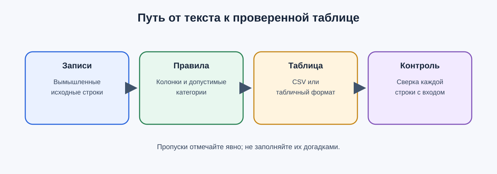

# Урок 6. Таблицы и данные

**Цель:** применять ИИ для структурирования небольших массивов данных и проверять преобразование.

## Коротко

Модель может классифицировать записи, предложить формулы, объяснить таблицу или привести текст к единому формату. До передачи данных убедитесь, что их можно загружать в выбранный сервис. Для практики достаточно искусственных данных.

Чётко задавайте названия колонок, допустимые значения и правило для неизвестных сведений. Просите не додумывать пропуски и отмечать неоднозначные строки. Сверяйте выборку с оригиналом, особенно даты, суммы, проценты и категории.

## Практика: классифицировать заявки и проверить таблицу (30–45 минут)

Используйте только эти вымышленные строки:

- «Доставка задержалась, заказ 104, хочу узнать новую дату»
- «Заказ 105: пришёл повреждённый товар»
- «Не могу войти в личный кабинет»
- «Заказ 106, где моя посылка?»

1. В ChatGPT или Codex вставьте строки и попросите вернуть CSV ровно с колонками `номер,тема,следующее_действие`. Для отсутствующего номера используйте `не указан`; для темы выберите одно из значений `доставка`, `повреждение`, `доступ`. Не придумывайте дату доставки и не назначайте исполнителя.
2. Попросите объяснить правила классификации и отметить неоднозначные строки. Сверьте четыре строки с оригиналом вручную.
3. В Codex попросите создать файл `praktika/moj-mini-proekt/zayavki.csv` и показать его содержимое. В ChatGPT скопируйте CSV в текстовый редактор или рабочую тетрадь. В обоих случаях проверьте разделители и кавычки.
4. Попросите предложить формулу подсчёта строк по теме для Google Sheets или Excel, назвав выбранный продукт и колонку. Спросите, что изменится при русской локали (разделители аргументов и имена функций могут отличаться).
5. Не загружая файл в реальную систему, проверьте четыре значения. Если нашли ошибку, попросите выбранный инструмент исправить только соответствующую строку и перепроверьте её.

**Результат:** проверенный CSV-результат, явные правила для пропусков и формула с указанием среды. В Codex сохраните файл как `praktika/moj-mini-proekt/zayavki.csv`; в ChatGPT — в тетради или текстовом файле.
