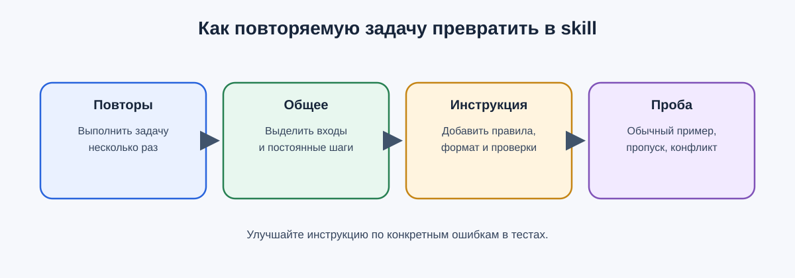

# Урок 7. Повторяемые задачи и skills

**Цель:** понять, что такое skill и когда он полезен.

## Что такое skill

В этом курсе skill — это сохранённая инструкция для повторяемой задачи: описание цели, нужного контекста, последовательности действий, ограничений и формата ответа. В некоторых ИИ-инструментах skills могут подключаться автоматически или вызываться явно. Точный формат и возможности зависят от продукта; папка `skills/имя/SKILL.md` в этом курсе служит понятным переносимым примером.

Skill особенно полезен, если задача возникает часто, вы умеете оценить результат, а качество зависит от последовательных шагов. Он не делает модель безошибочной и не даёт ей доступ к данным или приложениям сам по себе. Подключайте только необходимые материалы и проверяйте действия перед отправкой или изменением данных.

## Практика: найти повторяемую процедуру (30–45 минут)

1. Выберите задачу, которую выполняете хотя бы раз в неделю и результат которой можете сами проверить. Подойдут протокол встречи из вымышленных заметок, сводка статуса или классификация учебных заявок.
2. Выберите ChatGPT или Codex и выполните задачу дважды, слегка изменив входные данные. В ChatGPT сохраните запросы в тетради; в Codex попросите читать только учебные файлы и создавать черновики в `praktika/moj-mini-proekt/`. Отметьте, какие сведения нужны и какие шаги повторяются.
3. При желании повторите примеры во втором инструменте и сравните количество уточнений, точность и объём правок.
4. В тетради выпишите обязательные входные данные, повторяющиеся шаги, формат ответа и три вероятные ошибки.
5. Попросите выбранный инструмент предложить инструкцию для повторного выполнения. В Codex сохраните черновик как `praktika/moj-mini-proekt/skill-draft.md`; в ChatGPT вставьте его в тетрадь.
6. Сравните его с примером [skill для протокола встречи](../skills/protokol-vstrechi/SKILL.md). Проверьте, указано ли, что делать при пропусках, как не выдумывать факты и как выглядит результат.

**Результат:** описание повторяемой задачи и черновик инструкции для skill.
