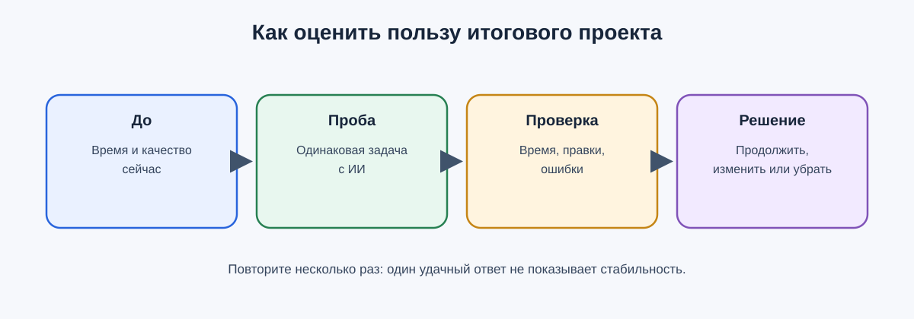

# Урок 9. Итоговый проект и план применения

**Цель:** собрать рабочий сценарий с понятным критерием пользы и проверки.

## Итоговый проект: личный рабочий помощник (60–90 минут)

Проект выполняется в Codex и является обязательной практикой. Возьмите задачу с низким риском и подготовьте искусственный набор из трёх входных примеров: обычный, неполный и противоречивый. Например, протокол из учебных заметок, сводка статуса или разбор учебных заявок.

### Выполнение

1. Откройте в Codex папку курса. Создайте отдельную рабочую папку `praktika/moj-mini-proekt/` и сохраните исходные примеры в `input/`. Используйте только вымышленные сведения.
2. Создайте skill в `.agents/skills/<короткое-имя>/SKILL.md`. Укажите назначение, необходимые входы, шаги, запрет на выдумывание данных, реакцию на пропуски, формат результата и короткую самопроверку. Можно использовать skill, созданный в предыдущем уроке.
3. В новом разговоре Codex вызовите skill явно. Попросите обработать один пример и сохранить результат в `output/`. До начала работы укажите границу: не отправлять сообщения и не редактировать исходники.
4. Проверьте результат построчно по источнику. Запишите время выполнения, число исправлений и пропущенные или добавленные факты.
5. Повторите для неполного и противоречивого примеров. Хороший результат задаёт уточнение или показывает расхождение вместо того, чтобы угадывать.
6. Исправьте skill и повторите только неудавшиеся случаи. Посмотрите, какие файлы Codex изменил. Оставьте только ожидаемые входы, skill и результаты; не принимайте непонятные изменения.
7. В ChatGPT вставьте тот же skill и один входной пример. Сравните точность и объём ручной работы. Зафиксируйте, что зависит от модели, а что стало возможным благодаря файловым инструментам Codex.
8. Заполните раздел 7 рабочей тетради и решите: продолжить опыт, изменить правила или отказаться от сценария.

### Критерии готовности

- Skill можно применить повторно к одинаково оформленным входам.
- Он не придумывает отсутствующие факты и обозначает противоречия.
- Результат можно проверить по исходнику.
- Понятно, сколько времени экономится и какая часть проверки остаётся человеку.
- Вы можете объяснить, какие файлы Codex прочитал и создал.

**Результат:** локальный skill, набор учебных входов и результатов, заполненная оценка пользы и решение о дальнейшем использовании.

## План на две недели

Выберите один или два безопасных сценария. Используйте их несколько раз и записывайте время, количество правок и типы ошибок. Продолжайте только если качество остаётся приемлемым и проверка не становится тяжелее самой задачи. Пересматривайте skill, когда меняется процесс или требования к данным.

